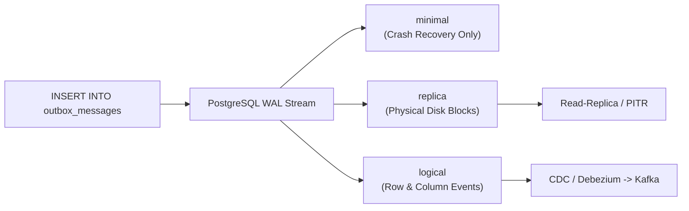

# PostgreSQL Write-Ahead Log (`wal_level`)

> [!abstract] Core Concept
> Before [[PostgreSQL]] modifies any table on disk, it first appends every change (`INSERT`, `UPDATE`, `DELETE`) to an internal transaction log called the **[[Write-Ahead Log (WAL)]]**. This guarantees durability (`ACID`) if the server loses power mid-transaction.

In [[docker-compose.yml]], PostgreSQL is configured with:

```yaml
command:
  - "postgres"
  - "-c"
  - "wal_level=logical"
```

The `wal_level` setting controls **how much context** PostgreSQL writes to the WAL stream.

---

## Visual Flow of `wal_level` Modes



---

## 1. `minimal` — Crash Recovery Only

> [!info] When to use
> Local or scratch databases where you only care about surviving a process crash and never need replication or point-in-time backups.

- **What it writes:** Only the bare minimum information needed to recover database consistency if the server crashes mid-transaction. For bulk operations (`CREATE TABLE AS`, `CLUSTER`, `COPY` into a new table), it skips writing WAL altogether and flushes data files to disk at commit time.
- **Write Overhead:** Baseline (lowest disk I/O).

> [!example] What gets recorded on `INSERT`
> ```text
> [Physical] Heap Page 42, Offset 3: write 128 bytes (crash recovery records only)
> ```

> [!warning] Limitation
> You **cannot** use [[Physical Read-Replicas]], WAL archiving, or [[Point-in-Time Recovery (PITR)]] backups.

---

## 2. `replica` — PostgreSQL Default

> [!info] When to use
> Standard production databases using physical standby replicas and continuous backups.

- **What it writes:** Every **physical disk block change** (for example: *"In relation file `16389`, block `42`, byte offset `3`, write these raw tuple bytes"*).
- **What uses it:** [[Physical Read-Replicas]] and [[Point-in-Time Recovery (PITR)]]. Because a physical replica is an exact binary clone of the primary database, it simply copies those raw disk block changes to its own disk files.
- **Write Overhead:** Standard default.

> [!example] What gets recorded on `INSERT`
> ```text
> [Physical] RelNode 16389, Block 42, Offset 3: raw tuple bytes 0x8f14...
> (knows physical disk addresses, NOT logical table/column names)
> ```

> [!warning] Limitation
> External tools like [[Debezium]] or [[Kafka Connect]] **cannot** decode raw physical disk addresses into meaningful JSON events without full access to PostgreSQL's internal catalog state.

---

## 3. `logical` — Required for Change Data Capture (CDC)

> [!tip] Why we use this in [[Transactional Outbox Pattern]]
> Enables **[[Log-Based CDC]]** so tools like [[Debezium]] can stream `INSERT`s from `outbox_messages` directly into [[Apache Kafka]] without running polling `SELECT` queries.

- **What it writes:** Everything included in `replica`, **plus extra catalog/tuple metadata** so PostgreSQL's built-in logical decoding plugin (`pgoutput`) can translate physical disk changes back into **row-level logical events**.
- **What uses it:** Logical replication and [[Change Data Capture (CDC)]] tools like [[Debezium]], which tail the WAL via a [[Replication Slot]] and stream row changes to [[Apache Kafka]].
- **Write Overhead:** Adds roughly **5–10% extra WAL disk I/O and storage overhead** on write-heavy workloads.

> [!example] What gets recorded on `INSERT`
> ```text
> [Physical] Heap Page 42, Offset 3: write 128 bytes
> [Logical]  TABLE public.outbox_messages: INSERT:
>              id[uuid]:'8f14..'
>              event_type[varchar]:'OrderCreated'
>              payload[jsonb]:'{"total":99}'
> ```

---

## Summary Comparison

| `wal_level` | Crash Recovery | Physical Read-Replicas & PITR | Logical Decoding & [[Change Data Capture (CDC)\|CDC]] | WAL Write Overhead |
| :--- | :---: | :---: | :---: | :--- |
| **`minimal`** | ✅ | ❌ | ❌ | Lowest |
| **`replica`** *(default)* | ✅ | ✅ | ❌ | Standard |
| **`logical`** | ✅ | ✅ | ✅ | +5–10% on heavy writes |

---

## Related Notes
- [[Transactional Outbox Pattern]]
- [[Polling Publisher vs Log-Based CDC]]
- [[Idempotent Consumers]]
